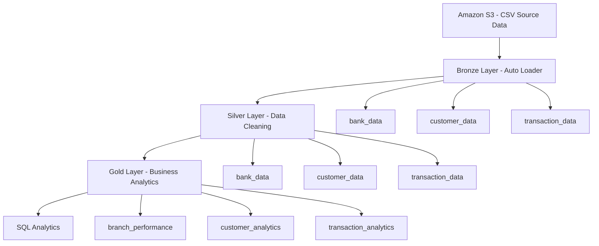

# Banking Data Engineering Project — Medallion Architecture

## Overview

This project implements an end-to-end banking data pipeline using **Databricks, PySpark, Lakeflow Declarative Pipelines, Amazon S3, and Unity Catalog**.

The pipeline ingests banking datasets from Amazon S3, processes them through the Bronze, Silver, and Gold layers of the Medallion Architecture, and produces analytics-ready datasets for business reporting and analysis.

The project focuses on incremental ingestion, data quality, data standardization, transformation, and business-oriented analytical datasets.

## Architecture

The pipeline follows the Medallion Architecture:

**Amazon S3 → Bronze → Silver → Gold → Analytics**

- **Bronze:** Ingest raw source data from Amazon S3.
- **Silver:** Clean, validate, standardize and transform the data.
- **Gold:** Prepare business-oriented datasets for analytical queries.

## Architecture Diagram



## Technologies Used

| Technology | Purpose |
|---|---|
| Python | Pipeline development |
| PySpark | Distributed data processing and transformation |
| Databricks | Data engineering platform |
| Lakeflow Declarative Pipelines | Declarative pipeline development and management |
| Amazon S3 | Source data storage |
| Unity Catalog | Data governance and table management |
| SQL | Data validation and business analysis |
| Delta Lake | Managed pipeline table storage and data reliability |

## Source Datasets

The project uses three banking CSV datasets stored in Amazon S3.

```text
s3://project-source-datas/Banking Data/
│
├── bank_data/
│   └── bank_data.csv
│
├── customer_data/
│   └── customer_data.csv
│
└── transaction_data/
    └── transaction_data.csv
```

### Dataset Description

| Dataset | Description |
|---|---|
| `bank_data` | Branch information, revenue, expenses and profit margin |
| `customer_data` | Customer information, demographics and branch relationships |
| `transaction_data` | Transaction information, balances and investment details |

## Data Pipeline

### 1. Bronze Layer — Raw Data Ingestion

The Bronze layer ingests data from Amazon S3 using Databricks Auto Loader.

#### Objectives

- Ingest CSV datasets from Amazon S3.
- Support incremental file ingestion.
- Handle schema discovery and schema evolution through Auto Loader configuration.
- Preserve raw source information.
- Maintain ingestion metadata and source file lineage where available.

#### Bronze Tables

| Table | Source |
|---|---|
| `banking.bronze.bank_data` | `bank_data.csv` |
| `banking.bronze.customer_data` | `customer_data.csv` |
| `banking.bronze.transaction_data` | `transaction_data.csv` |

### 2. Silver Layer — Data Cleaning and Standardization

The Silver layer processes Bronze datasets to improve data quality, consistency and usability.

#### Transformations performed

- Standardized column names.
- Converted columns into appropriate data types.
- Trimmed unnecessary whitespace from text fields.
- Removed duplicate records based on business identifiers.
- Validated required fields using data quality expectations.
- Checked financial values for invalid negative amounts according to defined validation rules.
- Validated customer references against the customer dataset.
- Converted transaction date strings into date values.
- Identified and preserved missing-data indicators.
- Retained source lineage and ingestion metadata where applicable.

#### Silver Tables

| Table | Key Transformations |
|---|---|
| `banking.silver.bank_data` | Branch data cleaning, numeric conversion and missing revenue identification |
| `banking.silver.customer_data` | Customer standardization, age validation and missing-data handling |
| `banking.silver.transaction_data` | Transaction type standardization, financial data conversion and date validation |

#### Data Quality

Data quality expectations were implemented to validate important fields and business rules.

Examples:

- Valid branch identifiers.
- Valid customer identifiers.
- Valid transaction identifiers.
- Valid financial values.
- Valid customer references.
- Valid transaction dates.

Data quality expectations were configured to report violations without automatically discarding records where appropriate.

### 3. Gold Layer — Business Analytics

The Gold layer transforms cleaned Silver datasets into business-oriented analytical datasets.

#### Gold Tables

**1. `banking.gold.branch_performance`**

Provides branch-level financial analysis.

Key fields:

- Branch ID
- City
- Region
- Firm revenue
- Expenses
- Calculated profit
- Calculated profit margin
- Missing revenue indicator

Business calculations:

```text
Calculated Profit = Revenue - Expenses

Calculated Profit Margin =
    (Calculated Profit / Revenue) * 100
```

Use cases:

- Regional profitability analysis.
- Branch performance comparison.
- Revenue and expense analysis.
- Profit margin analysis.

**2. `banking.gold.customer_analytics`**

Provides customer-level analytical information with age segmentation.

Key fields:

- Customer ID
- Age
- Age group
- Customer type
- City
- Region
- Bank name
- Branch ID
- Missing-data indicators

Age segmentation:

| Age | Segment |
|---|---|
| Below 25 | Young Adult |
| 25–40 | Adult |
| 41–60 | Middle Aged |
| Above 60 | Senior |
| Missing | Unknown |

Use cases:

- Customer demographic analysis.
- Customer segmentation.
- Regional customer distribution.
- Customer type analysis.

**3. `banking.gold.transaction_analytics`**

Provides transaction-level analytical data with transaction amount classification.

Key fields:

- Transaction ID
- Customer ID
- Account type
- Total balance
- Transaction amount
- Transaction category
- Investment amount
- Investment type
- Transaction date

Transaction amount classification:

| Transaction Amount | Category |
|---|---|
| Below 2,000 | Low |
| 2,000–5,000 | Medium |
| Above 5,000 | High |

Use cases:

- Transaction volume analysis.
- Account type analysis.
- Investment analysis.
- Transaction amount segmentation.
- Financial trend analysis.

## Data Quality and Validation

Validation was performed across the Bronze, Silver and Gold datasets.

Checks included:

- Missing values.
- Duplicate identifiers.
- Numeric type conversion.
- Financial value validation.
- Customer referential integrity.
- Date validation.
- Gold record counts.
- Gold transformation output validation.

## Business Insights

The project produced the following analytical observations from the processed dataset.

### Branch Performance

- The South region had the highest calculated total profit among the four regions.
- South had the highest calculated overall profit margin in the regional analysis.
- Regional profitability was compared using revenue, expenses and calculated profit.

### Customer Analytics

- Customers were segmented into Young Adult, Adult, Middle Aged, Senior and Unknown groups.
- Missing age records were retained under the Unknown segment.
- Middle Aged and Senior segments represented a significant proportion of the dataset.

### Transaction Analytics

- Transactions were classified into Low, Medium and High categories.
- Savings accounts generated the highest aggregate transaction amount in the analyzed dataset.
- Current accounts had the highest summed balance in the query output; this figure should be interpreted according to the source balance's data grain.

## Project Structure

The repository structure is:

```text
banking-data-engineering/
│
├── databricks.yml
│
├── resources/
│   ├── banking_pipeline.pipeline.yml
│   └── banking_pipeline_daily_10pm.job.yml
│
├── Pipeline/
│   └── transformations/
│       ├── bronze/
│       │   ├── banking_data_bronze.py
│       │   ├── customer_data_bronze.py
│       │   └── transaction_data_bronze.py
│       │
│       ├── silver/
│       │   ├── banking_data_silver.py
│       │   ├── customer_data_silver.py
│       │   └── transaction_data_silver.py
│       │
│       └── gold/
│           ├── branch_performance_gold.py
│           ├── customer_analytics_gold.py
│           └── transaction_analytics_gold.py
│
└── README.md
```

*The bundle deployment files (`databricks.yml`, `resources/`) define the pipeline and its scheduled job as code.*

## Pipeline Workflow

1. Store source banking datasets in Amazon S3.
2. Ingest source data using Databricks Auto Loader.
3. Create Bronze tables using Lakeflow Declarative Pipelines.
4. Read Bronze data and apply cleaning and validation transformations.
5. Create Silver tables with standardized data types and columns.
6. Read Silver tables and apply business transformations.
7. Create Gold analytical tables.
8. Validate the Gold datasets using SQL.
9. Perform business analysis on the resulting datasets.
10. Refresh the pipeline daily at 22:00 using the scheduled job.

## Orchestration and Scheduling

The pipeline is orchestrated by the Databricks job `banking-pipeline-daily-10pm`, defined in `resources/banking_pipeline_daily_10pm.job.yml`.

- Triggers a full update of the banking pipeline every day at 22:00 (Asia/Calcutta timezone).
- The job's single task runs the pipeline update, so a failed update marks the job run as failed.
- Scheduling the job allows unattended daily refreshes without manual runs.

## Deployment — Declarative Automation Bundle

The project is packaged as a Declarative Automation Bundle, so the pipeline and its scheduling job are deployed together from source control.

- `databricks.yml` defines the bundle name, variables (catalog `banking`, Bronze schema `bronze`) and a `dev` development target.
- `resources/banking_pipeline.pipeline.yml` defines the Spark Declarative Pipeline: serverless compute, Photon, Auto Loader libraries from `Pipeline/transformations/`.
- `resources/banking_pipeline_daily_10pm.job.yml` defines the daily 10 PM scheduling job.

Common bundle commands, run from the repository root:

```text
databricks bundle validate --target dev
databricks bundle deploy --target dev
databricks bundle run banking_pipeline_daily_10pm --target dev
```

## Key Learnings

- Implementing Medallion Architecture in Databricks.
- Incremental ingestion using Auto Loader.
- Developing declarative data pipelines.
- Data quality expectations and validation.
- PySpark data transformations.
- Data standardization and missing-data handling.
- Referential integrity validation.
- Financial data type handling.
- Building analytics-ready Gold datasets.
- SQL-based business analysis.

## Future Enhancements

- Add pipeline monitoring and alerting.
- Implement automated data quality reporting.
- Develop BI dashboards using Power BI.
- Implement incremental processing optimizations in downstream layers.
- Extend the bundle with CI/CD automation, for example GitHub Actions deployments.
- Implement stronger data governance and access controls.

## Author

**Data Engineering Portfolio Project**

Built using Databricks, PySpark, Lakeflow Declarative Pipelines, Amazon S3 and Unity Catalog.
